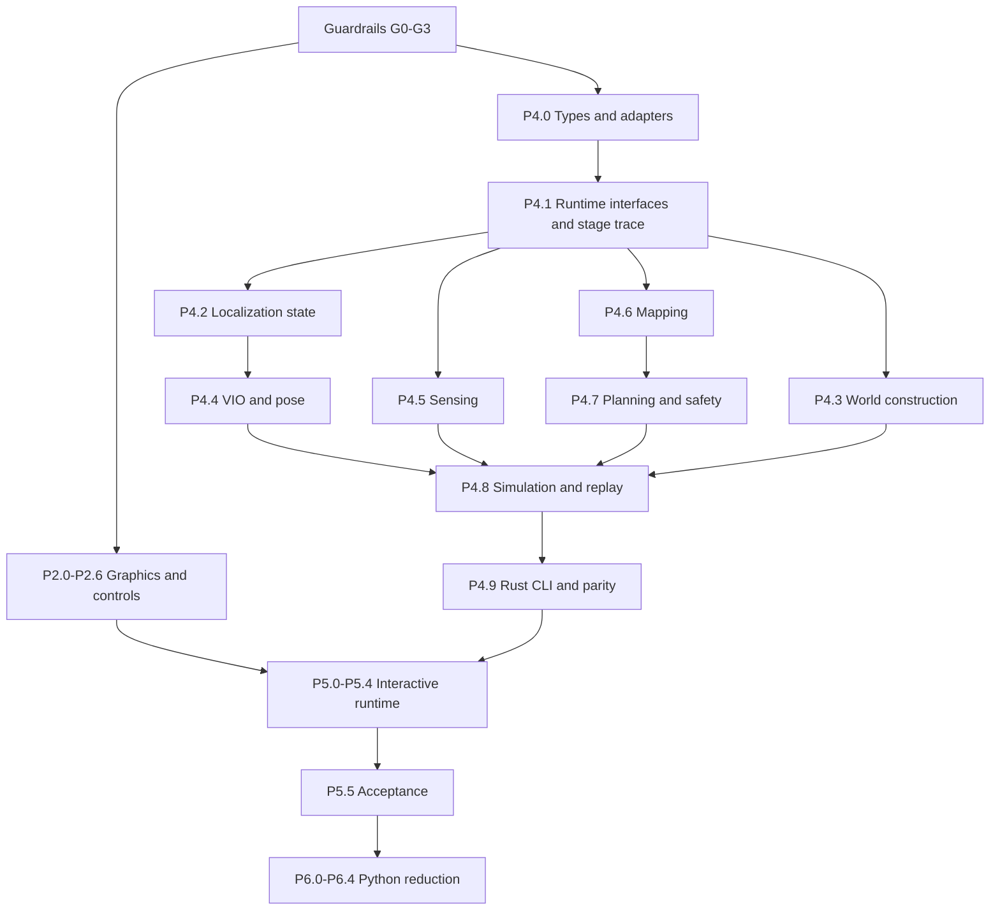

# Remaining Migration: Delivery Plan

This plan covers every open migration phase. Product roadmap numbering in
[ROADMAP.md](../ROADMAP.md) is independent. The baseline table is updated from
integrated checkout `ba163ac`; package descriptions remain target acceptance
contracts. An implemented library does not imply a shipping runtime consumer.

[Architecture and protocols](ARCHITECTURE_AND_PROTOCOLS.md) is the cross-cutting
contract. [Verification and rollout](VERIFICATION_AND_ROLLOUT.md) specifies gates.
Work package IDs are stable references for PRs and handoffs; they are not dates.
An implementation PR should normally close one package or a clearly identified
sub-slice, with its prerequisites and remaining work stated.

## September 23 execution-model amendment

Target architecture: [independently scheduled Rust runtime](../RUST_RUNTIME_ARCHITECTURE.md),
accepted by [ADR-009](../adr/009-independently-scheduled-runtime.md). The inventory
below retains its dated baseline; reviewed `ec9c2f7` also includes Rust replay
writing and control-state checkpoint/command fixes. Full domain lifecycle,
causal checkpoints and production scenario composition remain open.

Complete P4.8/P4.9, then run P5.0 basic viewer integration alongside P4.10a–f.
P5 history/live work consumes the final timestamp/freshness contracts. Existing
P/F/S identifiers are unchanged. Hardware qualification follows
[HARDWARE_INTEGRATION.md](../HARDWARE_INTEGRATION.md), not migration completion.

## 1. Baseline and scope

| Phase | Delivered | Still open |
| --- | --- | --- |
| 0 | Profile, work counters, replay/schema foundations, TLS guards, pins, proto regeneration and field-parity CI | Semantic contract inventory, frame-time budget and scanner triage |
| 1 | Bevy 0.19, shared dependencies/features, real headless renderer and CI smoke | Ongoing compatibility maintenance; no migration redo |
| 2 | Interpolation, typed selection, stage gating, HDR/bloom/fog/sky, persistent typed mesh markers and holographic shader | Full ECS snapshot path, terrain/belief material, sensor/zone/trail geometry, picking, camera/time/UI, visual regression and frame budget |
| 3 | Rust world/safety authority, native bridge, shared viewer sampling; P4.3g procedural landscape builders now merged | Integrate world boot/LOD and preprocessed imported-world consumers |
| 4 | Shared types/replay, domain ports, P4.3g landscapes, P4.6d belief revisions, P4.8a mission state, P4.8b TickWorld and P4.8c stage bodies/direct fusion | Correct commands and complete checkpoints; finish controller/scenario composition, replay writer and Rust CLI qualification |
| 5 | No in-process viewer simulation yet | Worker/snapshots/commands, world boot/LOD, live world protocol, rewind and removal of Python boot dependencies |
| 6 | No broad Python reduction yet | Caller-driven deletions, analysis packaging, entry-point ownership and documentation |

Domain-port fixtures and the integration record are not evidence of a complete
Rust mission. See [current ownership](../STATE_OWNERSHIP.md) and
[the source review](../NEXT_REFACTOR_REVIEW.md).
The current marker mesh shader is not a terrain shader. The current CI colored
pixel assertion is not image regression coverage. Merged procedural builders do not mean the Python tick or viewer GLB boot
dependencies are gone.

## 2. Dependency graph and workstream coordination

Parallel work is possible after shared contracts are frozen, but integration
order stays explicit. Graphics owns renderer files; runtime owns domain crates;
protocol/DTO changes are reviewed jointly. Every PR names a responsible owner
and a reviewer for affected consumers. This does not require multiple agents
or concurrent edits to shared files.

Before a work package starts, publish a short handoff: base commit, package ID,
input/output contract versions, files/crates affected, test command/fixtures,
known limitations and downstream consumers. Interface-changing work includes a
sample payload and migration example. Update this plan's package status and
STATE_OWNERSHIP when a slice lands; do not mark an entire phase complete because
one new crate exists. Resolve semantic questions through an ADR instead of
inconsistent Slack/comment-only agreements. Reports must distinguish locally
verified, pushed, PR checks passing and merged.

## 2a. Viewer and feature handoff

[VIEWER_UI.md](../VIEWER_UI.md) governs the target shell, visual language,
source modes and operator acceptance. P2.0–P2.6 implement presentation against
replay/explicit fixtures; P4.6 supplies belief revisions; P5.0/P5.2 supply worker,
controls and history; P5.3 supplies coherent live state. Plan authoring and
inspection Review depend on mission/evidence contracts, not renderer completion.
The primary workspaces are Operate / Plan / Review; Diagnostics, Scenario Studio,
Reporting and Site catalog are secondary. Preserve the spec's flat typography-led
instrument layout, accessibility and semantic quality tiers.

[CAPABILITY_DELIVERY.md](../CAPABILITY_DELIVERY.md) maps F1 scorecards, F2 fault
scenarios, F3 explanations, F4 comparisons, F5 energy contingencies, F6 memory
and F7 adaptive inspection to backend owners and viewer surfaces. Early F1–F4
replay/evaluation slices can precede full Rust composition; runtime actuation
and adaptive tasks still require the validated execution pipeline.

## 3. Guardrails before larger ports

| ID | Deliverable | Exit evidence |
| --- | --- | --- |
| G0 | Inventory replay/proto/Python/core/viewer field parity, enum semantics and unsupported schema versions; add installed-wheel and clean-checkout contract jobs | Every payload is preserved, normalized explicitly or rejected; no silent missing-field success |
| G1 | One pinned proto regeneration command and CI no-diff check; compatible `grpcio-tools`/protobuf dependencies | Python generated bindings regenerate from committed proto; Rust generation still builds; no hand-edited generated files |
| G2 | Representative renderer fixtures and warm-up-aware CPU/GPU frame instrumentation; split software smoke from hardware timing | Baseline artifacts for overview, close view, low pitch, split mode and high entity count, with hardware/profile/viewport recorded |
| G3 | Triage informational scanners, retain pins and branch checks, add artifact/provenance checks | Findings resolved or documented with owner/expiry; required checks enabled individually after triage, never blanket ignored |

G0/G1 precede the first wire change. G2 precedes turning expensive effects on by
default. G3 can run alongside early ports but is a release dependency. Re-profile
a representative full run after each major port: the original 40% localization
figure predates native scoring and must not be treated as today's allocation.

## 4. Phase 2 — complete the viewer engine

### P2.0 — snapshot adapter and persistent presentation state

Replace per-frame `CurrentRuntimeMarkers` reconstruction/string cloning with a
single snapshot-to-ECS adapter. Keep typed platform/track/truth IDs and add typed
selectability/trail state. Stable IDs survive pause, seek, filtering and live
reconnect only within a valid run/epoch. Spawn/despawn on membership changes;
update transforms/quality only on changed data. Clear selection on removal and
invalidate incompatible interpolation when epoch/world changes.

Inputs: current replay adapter first, future `RuntimeSnapshot` later. Outputs:
persistent domain entities and versioned renderer resources. Use explicitly
ordered SystemSets (input, snapshot apply, presentation, picking, UI) and gate
optional work by visibility/dirty revisions. Keep resource cleanup systems active
when their overlays are off. Test entity/asset counts across long seek/reload
loops and compare allocation counts before/after. Do not replace `argusnet-sim`
with an ECS-owned second world.

### P2.1 — terrain and belief material

Author an embedded WGSL material using Z-up elevation/slope bands, anti-aliased
contours and land-cover tint. Supply a typed `BeliefRenderSnapshot` containing
exact grid origin/resolution/dimensions, observed mask, confidence, last-observed
tick and belief revision. Sampling/packing lives in one adapter; shaders MUST
NOT infer coverage from truth terrain color or distance to a drone.

Begin with a synthetic belief fixture and replay fields that actually exist.
When a replay lacks belief data, render an explicit unavailable/unknown state;
do not fabricate planner confidence. P4.6 supplies full live dirty-tile patches.
Separate class/observed discrete channels from confidence/time numeric channels;
use nearest sampling for categorical values, documented interpolation for other
channels and halo/edge handling across tiles. Upload only changed tiles, cap
texture dimensions/memory and expose failed/unavailable uploads. Validate pixel
probes against CPU belief queries at boundaries, stale/unknown cells and LOD
seams. Contour style is presentation, never another terrain evaluator.

### P2.2 — sensor, mission-zone and trail geometry

Keep the existing hologram material, but move sensor FOV into cone/frustum meshes,
mission zones into extruded boundary/volume geometry and trails into persistent
ribbons. Physical FOV/range volumes remain world-sized; platform glyph-like meshes
retain screen-size readability. Derive sensor axes from the same sensing pose
and limits as the runtime. Unknown/unset range keeps adapter semantics.

Cache topology/materials by sensor/zone shape; update transforms/parameters on
change. Trail sampling is time/distance-based with a bounded memory budget,
restart on teleport/epoch changes, and shrink/remove when IDs disappear. Define
transparency ordering, depth-test behavior and selection exclusions deliberately.
Use LOD/instancing only where measured instance counts justify it. Review visual
appearance at low pitch and extreme zoom; no effect may enclose the camera and
make the world invisible. Move remaining diagnostic gizmos behind a toggle once
an equivalent readable mesh path exists.

### P2.3 — picking, hover and focus identity

Replace the 18-pixel proximity picker with mesh raycasting filtered to visible,
selectable entities in the active viewport. Terrain/buildings must occlude picks;
transparent sensor volumes, trails, sky and zones must not steal a platform pick
unless explicitly selected in that interaction mode. Decide pick proxy geometry
for thin platform arms; it must be bounded by the visible glyph footprint.

Add hover feedback and a selection outline/material pass independent of the
normal hologram material, with no through-terrain outline by default. UI-captured
pointer input does not pick the world. Tests cover depth ordering, hidden truth,
split viewport coordinates, camera movement, despawn and same-label/different-kind
IDs. Inspect both pointer and keyboard selection workflows.

### P2.4 — camera and time controls

Retain orbit and add damped free-fly, selected-entity follow/chase, F-to-focus and
1-9 bookmarks. Camera controls use render delta time, not simulation dt. Scale
speed to altitude/scene size, clamp pitch/far planes for the Z-up world and apply
movement within the focused viewport. Follow loss returns to a stable camera
rather than snapping to origin. Remappable bindings cannot fire while typing.

Use time-based scrubbing over irregular replay timestamps, with interpolation,
loop and jump-to-event. Pause/step acts on the runtime command channel in Phase 5;
replay mode implements the same UI affordances locally. Display unavailable seek
ranges and live/read-only history separately from simulation rewind. Save camera
bookmarks as presentation preferences, not deterministic runtime state.

### P2.5 — mission-control shell and quality tiers

Specify palette tokens, typography/license, spacing, semantic colors and readable
contrast. Status must not rely on color alone. Provide a keybinding reference and
conflict-checked remapping. Avoid exposing transport/kernel implementation details
in operator flows; show actionable loading, stale-world, paused, recording and
fault states. Keep debug metrics in a diagnostic panel.

Evaluate environment fill, SSAO and color grading on actual scenes. Define low,
standard and high quality tiers with shared meaning; software CI can use a known
supported tier. Shadows and fog scale with camera/scene span. Do not enable every
post-process by default merely because Bevy supports it. Material compilation,
asset warmup and glyph visibility are part of visual QA.

### P2.6 — graphics acceptance

Run fixed replay/world fixtures through the real renderer in all quality tiers.
Publish visual diffs and timing/allocation evidence. Exit: runtime entities and
terrain/belief are readable at overview and close zoom; controls/picking work;
gizmos are optional diagnostics; no lifetime leak; designated hardware meets the
frame budget. Lavapipe smoke remains a shader correctness gate, not a 60 fps gate.

## 5. Phase 3 — retain one authority while extending consumers

No second terrain/safety engine is planned. Add ABI capability negotiation,
registry concurrency/lifetime tests and native error containment as new consumers
arrive. Preserve Python metadata/re-exports until callers migrate. Fix any newly
found geometry error with a minimal parity fixture and explicit baseline review.
Move procedural shaping in P4.3, not by declaring the existing Python generator
an offline-only tool before the Rust runtime can construct its own worlds.

## 6. Phase 4 — finish the Rust simulation runtime

### P4.0 — complete shared types and adapters

Start from `argusnet-types`, not another value crate. Complete the G0 field matrix;
extract rich replay DTOs/normalizers into `argusnet-replay`; keep runtime types free
of Bevy/prost. Viewer conversion to f32 happens once. Consolidate proto conversion
logic while preserving efficient ownership: move owned strings/vectors when owned,
borrow/clone only where needed, and share field policy instead of doubling it.

Add runtime/DTO conversion round trips covering all optional payloads and invalid
covariance lengths. Python-to-Rust and Rust-to-Python replay fixtures remain green.
No proto field is removed, renumbered or reinterpreted. Exit: one semantic
runtime type definition, documented compatibility DTOs, complete field ownership.

### P4.1 — simulation API, trace and deterministic execution substrate

Introduce a small `argusnet-sim` shell with config validation, integer clock,
explicit stages, command application and snapshot interfaces. Keep it runnable
with fixture sources; do not present it as the production replacement yet. Capture
Python stage traces for default, scan-map-inspect, opt-in safety, VIO, frontier,
POI and egress paths. Identify every mutable controller/cache and future-tick
side effect before moving code.

Implement deterministic keyed seed derivation and RNG/math conformance fixtures
before changing stochastic stages. See verification policy: choose/pin algorithm
and normal sampler in a dedicated ADR-backed PR. Caller-provided fixed offsets
remain a deterministic test input, not a permanent second RNG authority. Exit:
trace harness, reset semantics, fault behavior and snapshot headers are testable
without viewer/network/file output.

#### P4.1 corrective gate before composition and viewer controls

**Implemented locally after `45390b8`:** command protocol v2 repairs queued
fault/completion reset, exactly-one-tick stepping, due/future reset cancellation,
execution-time revision validation, invalid speed/past-tick refusal and bounded
idempotency with payload conflict detection. `command_ack` exposes Accepted,
Applied, Rejected and Cancelled; retries retain the outcome with `duplicate=true`.
Checkpoint metadata validation and O(1) clock restoration are also implemented.
Runtime algorithm version 2 rejects checkpoints carrying the previous control
semantics. Checkpoint format 2 additionally persists pause/speed, revision,
pending controls and bounded retry receipts/request identities/retirement state;
JSON round-trip tests verify fresh-instance control resume and atomic refusal.
Restore replaces the receiving run's old retry history. Full causal subsystem checkpointing and a durable event journal remain
open; do not mark P4.1/P5 controls fully complete on this evidence alone.

Fix queued reset while faulted/completed, exactly-one-tick SingleStep, duplicate
result preservation, reset epoch barriers and speed/effective-tick validation.
Use explicit subsystem-owned state with reset/checkpoint/restore coverage.
Validate checkpoint world identity and bounds before mutation; preserve causal
command/dedup state; restore clock in O(1); invalidate presentation across seeks.
Tests must drive the command API through recovery and compare real stateful
uninterrupted versus fresh-process resumed missions. The shell's passing trace
fixtures alone do not satisfy this gate. See protocol sections 5–6 and the
[source findings](../NEXT_REFACTOR_REVIEW.md).

### P4.2 — full GridLocalizer state

Move estimates, per-platform step counts, timeout state, particle generation,
annealing, weighting, confidence and inverse-variance fusion to
`argusnet-localization`; reuse native coverage scoring. First validate all
non-random formulas using recorded offsets. Then migrate PRNG explicitly under
ADR-006 with predeclared statistical envelopes. Preserve reset behavior, no-map
early returns, elevation handling and duplicate/missing platform semantics.

Expose a transitional native estimator handle so the Python tick uses Rust state
while other stages remain Python. Remove the Python estimator math after parity;
retain only config/result adapters. Add `LocalizationStatus` to the runtime/DTO
contract so timeout, unavailable map and actual convergence are distinguishable.
Keep legacy forced confidence only under the compatibility profile until a
separate mission-gating change is reviewed. Re-profile full localization and
record ABI/state-transfer cost rather than repeating the scoring-only benchmark.

#### Current port evidence

P4.3g landscape construction and P4.6d belief publication are merged. P4.8a–c
adds mission transitions, mutable TickWorld, stage-scoped truth access, populated
snapshots and stage bodies including direct fusion. See
[LANDSCAPE_BUILDERS.md](LANDSCAPE_BUILDERS.md),
[BELIEF_REVISIONS.md](BELIEF_REVISIONS.md), [MISSION_STATE.md](MISSION_STATE.md),
[TICK_WORLD.md](TICK_WORLD.md) and [TICK_STAGES.md](TICK_STAGES.md).
Package descriptions below remain acceptance contracts. Integration into an
installed representative mission and viewer is a separate completion gate.

### P4.3 — runtime world construction

Port procedural height shaping, smoothing/detail, hydrology/semantic masks,
seasonal land cover and obstacle construction into `argusnet-world` builders.
Parameter/preset data becomes a versioned data asset consumable by Rust and
Python tooling. Validate units/ranges and generation version; use one seed scheme.
Batch terrain and categorical construction; avoid serializing full grids during
each builder stage.

DEM/GIS decoding may stay in offline import tools, but the Rust runtime accepts
a documented preprocessed world bundle directly. Pure synthetic defaults MUST
need neither Python nor GLB baking. World builds have cancellation/progress,
content hashes and bounded caches. Tests cover all presets, tile seams, missing
coverage and exported metadata consistency. Exit: representative worlds construct
in Rust with recorded startup timing and no Python process.

### P4.4 — VIO and pose pipeline

Port odometry/VIO/GNSS fusion, relevant transforms and implemented relocalization
or pose-graph behavior into the localization crate. Inventory which helper
modules are actually wired before porting stubs. Separate synthetic IMU/features
from the estimator so recorded/real observations can use the same estimator.
Preserve frame transforms, covariance units, initialization, reset and pose
substitution into sensing/fusion.

Test zero motion, turning, timestamp gaps, bias drift, GNSS loss/recovery,
singular/invalid covariance and replayed observation fixtures. Define invalid or
stale pose behavior explicitly. No manufactured confidence on a failed estimator;
legacy behavior changes require separate validation. Exit: Python delegates the
wired estimator path and statistical/numerical envelopes pass.

### P4.5 — sensing and versioned sources

Port SensorModel, FOV/range/elevation gates, bias drift/noise, LOS/transmittance,
clutter behavior actually used and the rejection cascade into `argusnet-sensing`.
Preserve the newly merged `argusnet.observation-source/v1` compatibility boundary:
its Python request includes synthetic truth and RNG, but new generic Rust ingest
must not require truth. Define a synthetic request carrying restricted truth and
a separate observed-data source that produces the same batch contract.

`ObservationBatch` records attempted count, accepted observations, generation
rejections and counts by node/target/reason. Generation rejection remains distinct
from fusion rejection. Sources declare capabilities and version; unsupported
capabilities fail before the run. Test reordered nodes/targets, missing sensors,
weather/vegetation, threshold edges and occlusion-aware truth isolation. Exit:
Python generator becomes an adapter and acceptance/rejection envelopes pass.

### P4.6 — coverage and belief mapping

Move mutable CoverageMap/WorldMap state into `argusnet-mapping`. Introduce one
footprint rasterizer whose indices/weights feed both coverage and belief updates,
while preserving their distinct statistical meanings. Reuse the same grid layout
as localization. Replace repeated full-grid stats with revision-aware aggregates;
prove incremental totals against full reductions, including reset and removal.

Publish immutable belief revisions and dirty tile patches for planners and P2.1.
Carry observed/unknown, uncertainty, timestamp and evidence provenance. Define
out-of-bounds/missing-tile behavior and deterministic update order when multiple
sensors touch a cell. Test commutative updates where promised, deterministic
ordered updates where not, tile seams and no-truth-access. Exit: mapping is
load-bearing in the transitional Python loop and shared with the renderer.

### P4.7 — planning, battery, deconfliction and mission intents

Port visibility-graph routing, frontier claims, POI assignment/dwell, battery
accounting/reserves, egress and cooperative deconfliction as small modules.
Planner input is belief/pose/mission constraints; output is a proposal with
world/belief/pose revisions, validity interval and reason. Do not let a planner
apply transforms. Cache routes against actual input revisions and quantized
request keys; never reuse a route across a changed exclusion zone blindly.

Integrate the existing Rust safety engine after deconfliction. Keep mission
policy, hard physical limits and simulation collision correction distinguishable.
Test crossing routes, low battery, unreachable POIs, stale/unknown belief,
coordinator/claim changes and conflicting overrides. Log proposed/accepted motion
and clamp reason. Exit: ordering matches trace fixtures and the mission loop no
longer recomputes multiple identical routes per platform per tick.

### P4.8 — compose tick, mission state and replay

Replace Python orchestration with the P4.1 stages and explicit mission state.
Consume typed events once; preserve scan/localize/inspect/egress transitions and
the implemented mission-executor hooks without claiming the entire product
mission architecture is complete. Eliminate repeated dataclass-style list rebuilds;
freeze once at the snapshot boundary. Call `argusnet-core` directly.

Add complete checkpoints and a versioned Rust replay writer. Python evaluation
reads its output through strict schema validation. Compare direct-core results
with the gRPC adapter using identical fixture inputs. Export failures and tick
failures have distinct states. Exit: a full representative run is owned by Rust,
with no Python callbacks inside a tick, and all relevant fields survive replay.

### P4.8 completion gate — production ownership and lifecycle

Reject missing required production stages; retain empty shells only for explicit
tests. The session owns subsystem instances instead of exposing mutable stage
links to arbitrary callers. Reset reconstructs controllers, VIO/fusion, sensor
biases, mission/safety/battery and belief from resolved configuration. Complete
checkpoints contain these states and validate real world/config content identity.
Control-state persistence alone does not close this package. Exit: reset equals
a fresh run; restore equals uninterrupted execution; no Python callback in the
representative Rust mission. Keep behavior fixes separate from mechanical ports.

### P4.9 — Rust CLI and phase acceptance

Add `argusnet-cli` with a Rust `argusnet sim` command using the same library as the
viewer/server. During coexistence package it under an unambiguous development
binary such as `argusnet-rs`; do not let pip and Cargo overwrite each other's
`argusnet` executable. Versioned config files are the canonical input; adapters
translate legacy CLI flags with explicit unsupported-option errors.

Run the canonical scenario suite, edge profiles and multi-seed statistical tests.
Emit resolved config/version/provenance and record startup/tick distributions.
Preserve the frozen gRPC contract fixture unless its own contract actually
changes; new simulation goldens do not automatically require changing transport
fixtures. Exit: Rust CLI reproduces supported scenarios within approved envelopes,
no Python runtime dependency, direct fusion parity and meaningful perf gates.

### P4.10 — independently scheduled execution (new, planned)

P4.9 is the baseline dependency. Reuse domain algorithms; retain
`legacy_stages_v1` during opt-in `scheduled_v1` qualification. This is a versioned
behavior change, not permission to silently reorder compatibility fixtures.

| Package | Deliverable | Exit evidence |
| --- | --- | --- |
| P4.10a | Checked integer-time event scheduler, independent/rational sensor rates, fixed physical integration and declared off-boundary sampling | No cumulative deadline drift; stable ties; unsupported sampling rejected; pacing cannot change causal order |
| P4.10b | Timestamped sensor envelopes, source epochs/clock quality, elapsed-time estimator updates, prediction/expiry deadlines and buffered mapping inputs | Capture versus delivery preserved; empty-input track aging; explicit late/drop policy; no lost evidence at unequal rates |
| P4.10c | Dirty tile updates, spatial indexing, affected-route invalidation and buffer reuse | Reduced work counters, equivalent unchanged-input outputs, measured CPU/allocation cost |
| P4.10d | Bounded workers, job input revisions, cancellation and deterministic application boundaries | Same causal state across worker counts/completion order; stale jobs rejected; current safety revalidation |
| P4.10e | Full scheduler/sensor/job checkpoints, branch publication epochs, recording/backpressure and viewer freshness | Restore with delayed deliveries/pending jobs equals uninterrupted run; old-epoch messages ignored; bounded history |
| P4.10f | Balanced workload qualification and default promotion | Published accuracy, timing, memory and usability results; no new safety failures; rollback profile retained |

Periods do not have to be multiples of a global tick. A sensor model must support
its requested capture times; a high output frequency cannot manufacture physical
fidelity. Advanced delayed-measurement smoothing and flight dynamics are separate
capabilities. Live hardware deadlines/fallbacks are qualified in S3/S4.

P5.0 may ship after P4.9 without waiting for P4.10; expose only completed controls.
Retain legacy execution through scheduled qualification and the following release,
then retire it under P6 while preserving historical replay readers. Each package
PR records algorithm/seed/schema changes, evidence and rollback boundaries.

### Architecture completeness handoffs before promotion

- P4.3/P4.8/P5.1: resolved world manifests, physical/visual semantics, content
  validation, cancellation, deterministic tile generation and atomic publication.
- P4.8/P4.10b: track source identity, evidence versus prediction age, time-based
  lifecycle, deletion events and honest labeled/unlabeled source capabilities.
- P4.10a/f and S3/S4: distinguish unrestricted/paced virtual time from external
  deadline-coupled operation; freeze supported model/rate/sampling capabilities.
- P2/P5: compatible transform revisions, bounded upload/apply budgets, stale-pick
  checks and renderer-resource recovery without restarting the simulation.
- P4.8/P4.10e/P5.2: immutable run configuration, journal commit/durable cursors,
  verified crash recovery and explicit incomplete artifacts. Remote multi-client
  actuation is not included in read-stream completion.

See [simulation fidelity](../SIMULATION_FIDELITY.md) and the
[verification matrix](VERIFICATION_AND_ROLLOUT.md#additional-architecture-audit-gates).
These refine existing packages; they do not require replacing ported algorithms.

## 7. Phase 5 — run the world in the viewer

### P5.0 — worker and command integration

Link `argusnet-sim` into the viewer with the worker/command/snapshot protocol.
Deliver basic controls after P4.9 while P4.10 is opt-in; do not wait for full
scheduler completion. Seek remains unavailable until complete history is qualified.
Wire Run, pause/resume, speed, step and stop to acknowledged commands. World
preparation is cancellable and off the render thread. Loading a second scenario
must release old workers/handles/assets only when readers are finished. Invalid
configuration remains editable; a failed load must not show a half-new world.
Test rapid Run/Stop, repeated reload, queue saturation and close-during-load.

### P5.1 — Rust world boot and terrain LOD

Mesh terrain directly from immutable `argusnet-world` views. Use camera-driven
LOD with skirts/stitching and deterministic tile bounds; scheduling/upload can be
asynchronous, but world revision publication is atomic. Cache by content hash,
LOD and render-origin transform; cap CPU/GPU memory and evict unused tiles.
Near terrain must not disappear while a coarse tile is being replaced.

`.smartscene` remains import/export, not required boot state. Keep support for
legacy Z-up packages while new exporters follow the explicit glTF axis contract.
Test synthetic boot with no Python executable and imported preprocessed worlds
with no exporter installed. Raster/mesh sampling parity is tested at LOD seams.

### P5.2 — time, checkpoints and recording

Implement bounded snapshot/checkpoint history, deterministic seek/replay and
branching after new input. UI uses available-history bounds and reports recording
backpressure/failure. Test equivalence of uninterrupted execution and
checkpoint-restore-to-same-tick, including safety escalation, RNG, pending
commands, VIO and mapping. Rate changes must not change final deterministic state.
A live external stream offers historical viewing, not reversal of external state.

### P5.3 — world-aware live protocol

Implement ADR-008 additively: capability negotiation, world manifest/chunks,
revisioned frames/belief patches, resync and bounded retention. Update Python
bindings and Rust conversion/server/viewer together. Store mission zones/status
at the server authority; eliminate the hardcoded empty zone response. A zones
message definition alone does not close this package.

Test old V2/new client combinations, reordered/missing chunks, corrupt hashes,
restarts, replayed sequences, base-revision gaps, slow readers and non-loopback TLS.
Do not add remote control implicitly. Exit: live mode renders a coherent world
and actual mission state rather than floating markers with absent metadata.

### P5.4 — remove subprocess/runtime export path

Delete `simulation_python`, `spawn_simulation_child` and
`spawn_build_scene_child` after P5.0/P5.1 pass. Remove Python daemon auto-build from
library imports and replace temporary-port probing with server-selected port 0
plus an explicit readiness/address handshake where local daemon launching remains
needed for standalone clients. Rust viewer startup must not invoke Python, Cargo
or GLB export. Preserve offline commands under explicit analysis/export tooling.

### P5.5 — interactive acceptance

From a clean installed build, press Run on the designated performance scenario,
observe advancing world state at the chosen fixed dt and responsive 60 fps render
on reference hardware. Inspect the process tree: no Python descendant; unrelated
system Python processes are irrelevant. Verify pause/step/rewind, recording,
world/mission overlays, picking, camera modes and restart under load. Record
render CPU/GPU timings separately from sim ticks and catch-up lag. Exit includes
memory stability and graceful cancellation, not only a screenshot.

## 8. Phase 6 — reduce Python without breaking analysis

### P6.0 — caller inventory and deletion map

For every candidate module, list runtime callers, analysis/export callers, tests,
CLI entry points and public imports. Port used behaviors; delete unused stubs
with evidence. Resolve duplicate trajectory builders by behavior name and test,
not by keeping whichever file is shorter. Do not remove a whole directory while
an exporter or evaluator still imports a useful data type from it.

### P6.1 — pure analysis/config packaging

Separate lightweight configuration/replay value readers from the native bridge.
Python evaluation, reporting, GIS/export and benchmark sweeps must install and
import without building Rust when they do not request native functionality.
Retain optional native world/simulation tooling as a separate extra/package only
if there is a demonstrated caller. Publish supported wheel/platform policy and
an explicit source-build path; test sdist completeness.

### P6.2 — entry-point ownership and deprecations

Rust owns the production `argusnet` executable. Python provides
`argusnet-analysis` (and `python -m argusnet` compatibility where feasible) for
evaluation/export. Maintain a command migration table for every existing CLI
subcommand, flags, output format and exit code. A compatibility wrapper may
forward an explicit runtime request to an installed Rust binary; it MUST NOT
build the binary or search hardcoded interpreter paths. Unknown commands and
missing binaries fail with an installation instruction.

Deprecations require release notes and at least one documented compatibility
release where consumers exist. If an API has no supported external users and all
repo callers migrate atomically, record that evidence rather than keeping a stub
forever. Check Python exports/`__all__`, package data and schema paths after removal.

### P6.3 — module removal and documentation convergence

Delete migrated implementations in world/simulation/sensing/mapping/localization/
planning/safety as their last runtime callers disappear. Relocate exporter-only
GLB/GIS code first. Remove empty adapters/UI/indexing stubs only after import
inventory. Shrink mypy ignore lists and remove unused dependencies, dev tools and
orphan Rust/native compatibility paths. Retain one CLAUDE/AGENTS source.

Rewrite README module tree, installation, usage/CLI table, VIEWER_UI, architecture,
STATE_OWNERSHIP, KNOWN_GAPS, performance docs, changelog and release notes against
the shipped system. Preserve historical ADRs; supersede them explicitly where
needed. No "implemented" label may describe a proposed interface.

### P6.4 — migration acceptance and maintenance handoff

Test Rust-only runtime installation, Python-only analysis installation, supported
legacy replay/scene import, exports in a conformant glTF consumer, and upgrade
from the compatibility release. All required CI gates pass from a fresh checkout.
Publish final ownership/dependency map, before/after performance artifacts,
compatibility matrix and remaining product-roadmap gaps. Archive migration
checklists only after the release contains the work; a merged port is not an
installed release by itself.

## 9. Immediate execution queue

1. Retain implemented P4.1 command/control-state fixes; complete subsystem
   lifecycle and causal checkpoints rather than treating control persistence as
   full restore. Update causal-state inventories.
2. Retain implemented G1 regeneration/field checks; finish G0 semantic conversion
   and G2 visual/frame-time baselines. Follow the viewer specification for P2.
3. Consume merged P4.3g landscapes and P4.6d belief publication; finish P4.8
   controller/scenario composition, checkpoints/replay and P4.9 qualification.
   Preserve P4.8a–c mission/TickWorld/stage work rather than restarting it.
4. Start F1/F2/F3 replay/evaluation slices and F4 paired comparisons. Qualify
   physical truth isolation, localization and validated execution separately
   from legacy parity.
5. Ship P5.0 basic worker/controls after P4.9; run P4.10a–f alongside it.
   Connect full P5 history/live state to qualified timing/freshness contracts.
6. Complete F5–F7 through their dependency matrix; hardware promotion follows
   S3–S7 evidence independently of desktop acceptance.
7. Re-profile each profile, qualify scheduled execution, and retire old execution
   and Python runtime consumers under P6 packaging/compatibility gates.

## 10. Latest autonomous/viewer system handoff

Use [the feature UI plan](../VIEWER_FEATURE_INTEGRATION.md) with
[the autonomous system releases](../AUTONOMOUS_SYSTEM_PLAN.md). P2 supplies typed
3D selection, projections and the replay-first shell; extend P2.1 beyond surface
rendering only when S2 spatial chunks exist. P4.6 initially publishes surface
revisions and later adds versioned volumetric chunks. P4.8 supplies authoritative
trajectory, integrity, health and decision outputs. P5 connects the worker and
read-stream adapters without granting aircraft control.

Prioritize one observable workflow per slice: objective failure → event/evidence;
platform → task/constraint/contingency; 3D proposal → vertical/time validation;
prior/current → aligned change claim. All share source context and one timeline.
SIL/HIL case review follows S3/S4 contracts; aircraft command capability is a
separate later design and qualification gate. Preserve existing P/F IDs.
