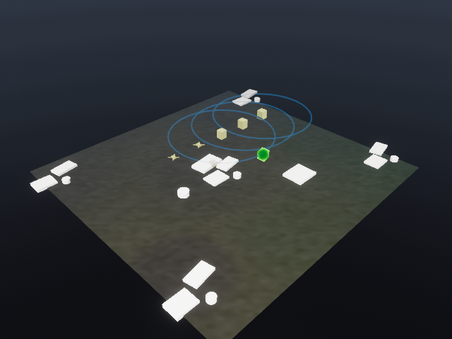

# Persistent marker meshes and native localization scoring

Built on the completed local Phase 3 work plus GitHub main `a7817d9`
(the observation-source contract from PR #43). This is an incremental delivery
of migration Phases 2 and 4, not completion of either phase.

## Graphics

Platforms, stations, tracks and optional truths now use persistent typed ECS
entities, shared meshes and an embedded holographic WGSL material. Drone arms,
station cuboids and distinct track/truth shapes replace the default wire glyphs.
The material uses a Fresnel rim, filtered Z-up scan bands and additive emission.
Markers retain screen-size scaling and track uncertainty color/size bands.
Transforms follow the existing interpolated replay state; horizontal velocity
sets heading. Velocity leaders and trails remain visible.

Entity IDs survive movement and visibility toggles. Missing IDs are despawned,
including when replay state is cleared or replaced. Mesh/material assets are
shared instead of allocated per marker per frame. A `Diagnostic Wire Glyphs`
checkbox restores the old symbols. Trails, sensor/zone overlays and selection
outlines still use gizmos; persistent ribbons/volumes and mesh picking remain
later Phase 2 work. `CurrentRuntimeMarkers` is still a per-frame snapshot.

The image uses synthetic display-test positions to separate airborne markers;
it is not a physical mission result. The CI smoke scene now includes this layout
and asserts green track pixels as well as a non-uniform image, so a terrain-only
render cannot hide a missing hologram pipeline. Isometric and top-down renders
were inspected locally. This is shader smoke coverage, not pixel-diff regression
coverage or a sustained frame-time benchmark.

## Runtime port

`argusnet-types` now owns the core runtime node, bearing, rejection, truth, track,
metrics and frame types plus horizontal bounds. Core/world re-export these values
for compatibility; proto conversions consume the shared definitions. Viewer f32
replay DTOs and conversion-function consolidation remain to be migrated explicitly;
the wire/replay schemas have not changed.

`argusnet-mapping` now owns particle-footprint coverage scoring. A native call
receives a contiguous coverage snapshot and all particle positions. An integer
summed-area table replaces repeated patch reductions and whole-grid copies:
one coverage copy per batch, followed by constant-time footprint queries. The
Python localizer delegates both its batch and compatibility scalar scoring path.

The port preserves clamped grid indices, exclusive patch upper bounds and the
empty-patch sentinel, including rectangular/single-axis grids and off-map points.
NumPy still generates particles and owns the estimator state/confidence/fusion;
this slice does not choose a new PRNG or require a golden re-baseline.
`argusnet-sim` and the Rust simulation CLI are not implemented yet.

## Measurement

On the same macOS arm64 machine with the release native library, a 200x200 grid,
200 particles and a 30 m footprint, median of 50 scoring batches:

| Path | Median |
| --- | ---: |
| Legacy per-particle copy/reduction | 1.599 ms |
| Rust batch including one Python grid copy and ABI call | 0.0415 ms |

About 38.5x faster for this kernel. These are local query timings, not end-to-end
simulation throughput or viewer FPS. Reproduce with
`PYTHONPATH=src python scripts/benchmark_localization.py` after building/installing
the release native library. Raw results: [JSON](phase4-localization-kernel.json).

## Verification

- Workspace build and tests: 196 Rust tests passed; viewer 103, including entity
  lifetime, visibility and asset reuse tests. Replay-only viewer has 95 tests.
- Python suite: 960 passed, 10 skipped, 65 subtests. New tests compare native
  scores and seeded localization updates against the old Python formula and
  assert one coverage snapshot per particle batch.
- Strict work-counter performance gate: passed without re-baselining; calibrated
  timing-only check remains opt-in. A Python 3.12 wheel was built and its scoring
  library loaded successfully outside the source tree.
- Workspace Clippy with all targets and warnings denied, Rust formatting, Ruff
  and mypy checked. Shader rendered through the real headless Bevy pipeline.

Next runtime work: complete value/DTO conversion consolidation, move estimator
state and the remaining localization computation into Rust, then VIO and the
remaining simulation stages. Preserve the versioned observation-source contract
while migrating sensing. Next graphics work: terrain/belief material, persistent
sensor/zone/trail geometry, mesh picking and operator camera controls.
